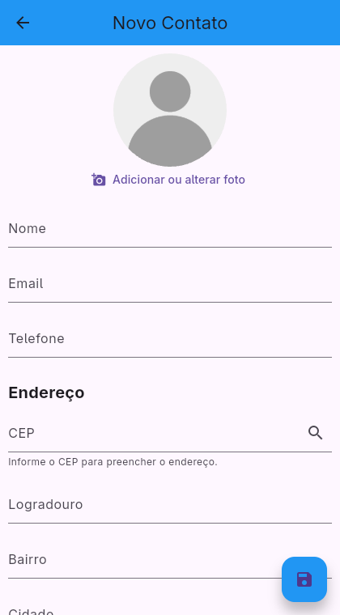
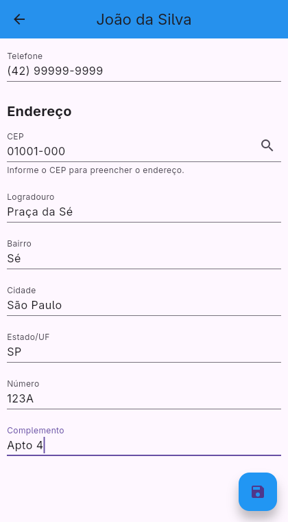
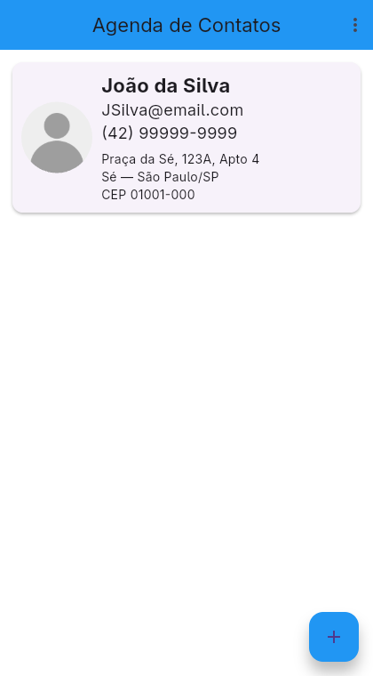
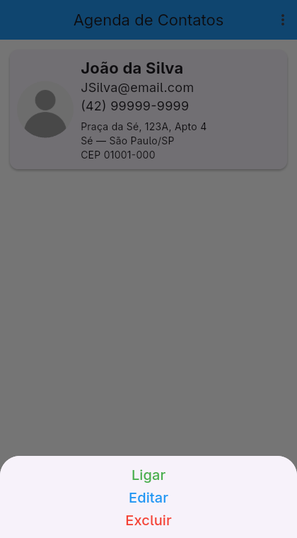

# Agenda de Contatos

Aplicativo Flutter de agenda de contatos com armazenamento local em SQLite, fotos e consulta de endereço por CEP.

**[Baixar o APK — versão 1.1.0](https://github.com/CaioNaLarica/agenda-de-contatos/releases/latest/download/agenda-contatos.apk)**

## Funcionalidades

- Cadastro, edição e exclusão de contatos, ordenação A–Z/Z–A e abertura do discador.
- Formatação de e-mail: remoção de espaços e domínio em minúsculas, preservando o texto antes de `@`.
- Validação obrigatória do e-mail antes de cadastrar ou alterar, com mensagem de erro.
- Telefone com máscara `(##) #####-####`.
- Foto pela câmera ou galeria no Android, salva no armazenamento permanente do aplicativo e exibida na lista e na edição.
- CEP com máscara `#####-###` e consulta automática ao completar oito dígitos, além de botão para repetir a busca.
- Preenchimento de logradouro, bairro, cidade e UF. Número e complemento são informados pelo usuário; todos os campos de endereço podem ser editados.
- Persistência de contatos, fotos e endereços, com migração do banco sem apagar registros anteriores.
- Tratamento de CEP inexistente, falta de conexão, tempo de resposta excedido e acesso negado à câmera ou galeria.

## Instalação

Baixe `agenda-contatos.apk` na [página da versão](https://github.com/CaioNaLarica/agenda-de-contatos/releases/latest) e instale em um dispositivo com Android 7.0/API 24 ou superior. Caso solicitado pelo sistema, autorize a instalação pela origem utilizada para abrir o arquivo.

A consulta de CEP precisa de internet. O cadastro e a edição continuam disponíveis sem rede, com preenchimento manual do endereço. Os dados ficam armazenados no dispositivo; desinstalar o aplicativo apaga seus dados locais.

## Telas

| Cadastro | Endereço |
| --- | --- |
|  |  |

| Contato salvo | Ações |
| --- | --- |
|  |  |

As capturas foram realizadas na versão Linux, que utiliza as mesmas telas Flutter.

## API de endereço

A integração utiliza o [ViaCEP](https://viacep.com.br/):

```text
GET https://viacep.com.br/ws/{cep}/json/
```

O CEP é enviado com oito dígitos. Logradouro, bairro, cidade e UF são preenchidos a partir da resposta. Número do imóvel e complemento particular são preenchidos manualmente. A consulta não exige chave de acesso e transmite somente o CEP.

## Executar e compilar

É necessário ter Flutter e Android SDK instalados. O projeto utiliza Dart `^3.13.1`.

```bash
flutter pub get
flutter run -d <id-do-dispositivo>
```

Para compilar o APK:

```bash
flutter build apk --release --no-android-gradle-daemon
```

O arquivo será gerado em `build/app/outputs/flutter-apk/app-release.apk`.

Para gerar os pacotes Android e Linux em sequência:

```bash
./scripts/compilar.sh
```

O script salva o APK em `output/agenda-contatos.apk` e o pacote Linux em `output/agenda-linux.tar.gz`. O Gradle utiliza um trabalhador, e o script limita a compilação Linux a um processo.

A versão Linux pode ser iniciada por `./output/agenda-linux/iniciar-agenda.sh`. No Linux, fotos são escolhidas pelo seletor de arquivos; a captura pela câmera está disponível no aplicativo Android. A ação Ligar exige um aplicativo associado ao esquema `tel:`.

## Estrutura

```text
lib/
  database/
    helper/     # Operações e migração do SQLite
    model/      # Dados do contato
  services/     # Consulta de CEP e armazenamento de fotos
  utils/        # Formatação e validação de e-mail
  view/         # Listagem, formulário e avatar
  main.dart
```

## Testes

```bash
flutter analyze
flutter test --concurrency=1
CMAKE_BUILD_PARALLEL_LEVEL=1 flutter test integration_test/app_test.dart -d linux
```

Foram aprovados nove testes de unidade/widget e um teste de integração Linux, incluindo consulta real ao ViaCEP e persistência após reabertura do banco. Veja o [roteiro de verificação](docs/TESTES.md).

A captura física e as permissões de câmera Android devem ser verificadas em aparelho real. O APK de entrega usa a chave de desenvolvimento do projeto para instalação e avaliação local.
